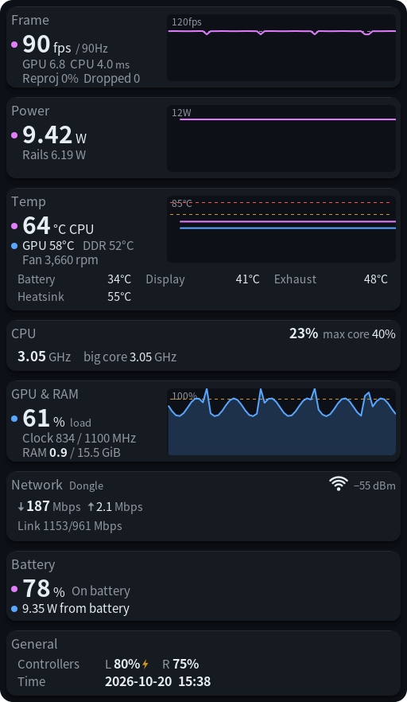
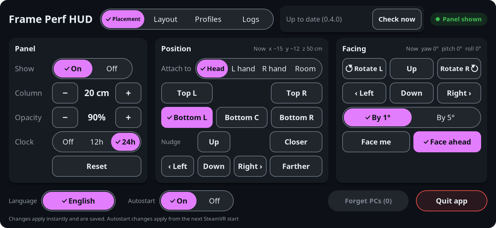
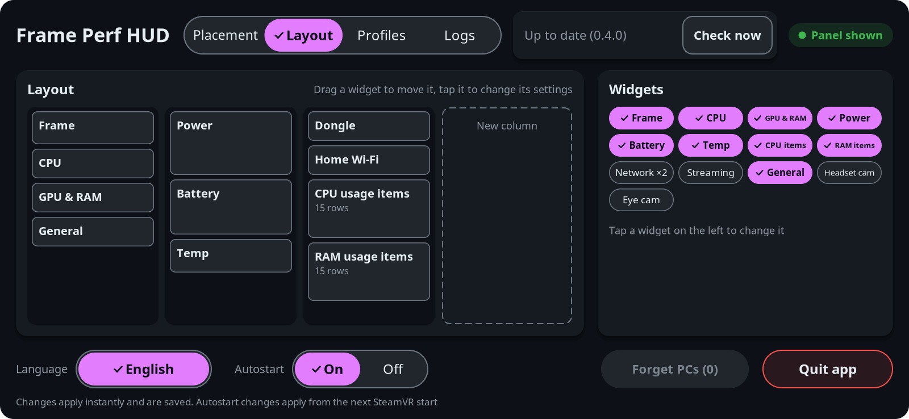
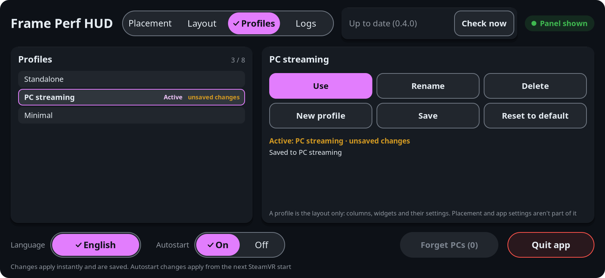
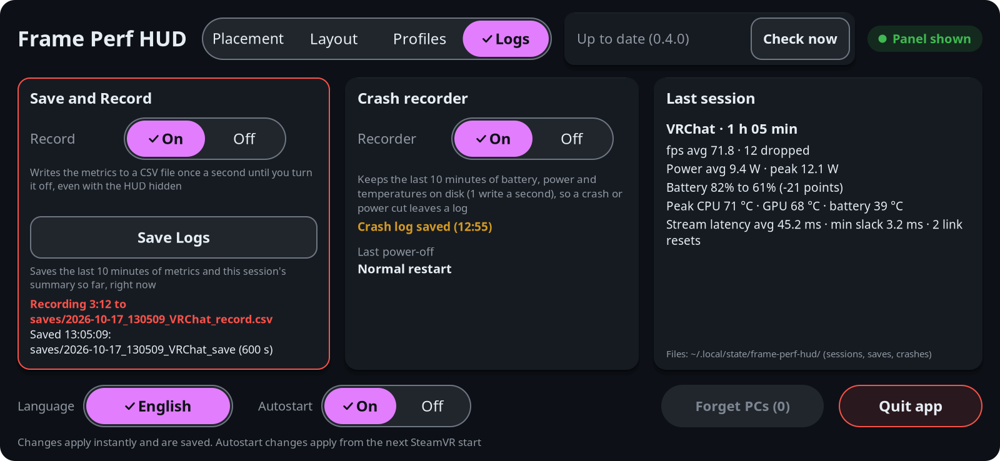
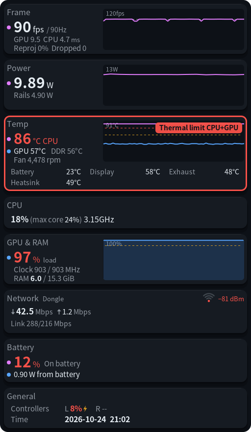
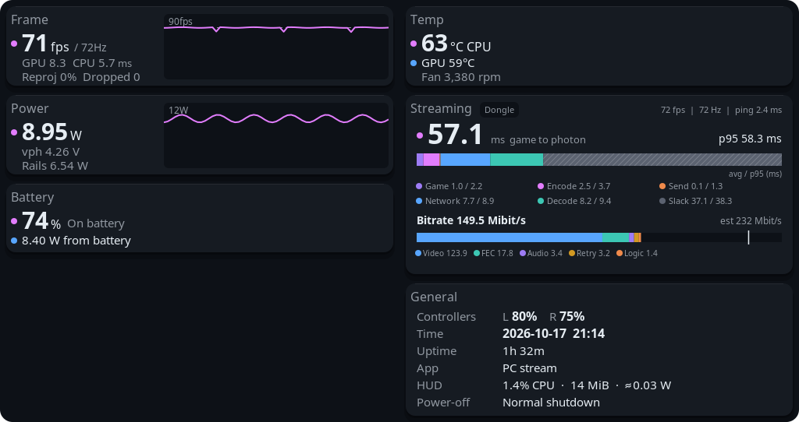
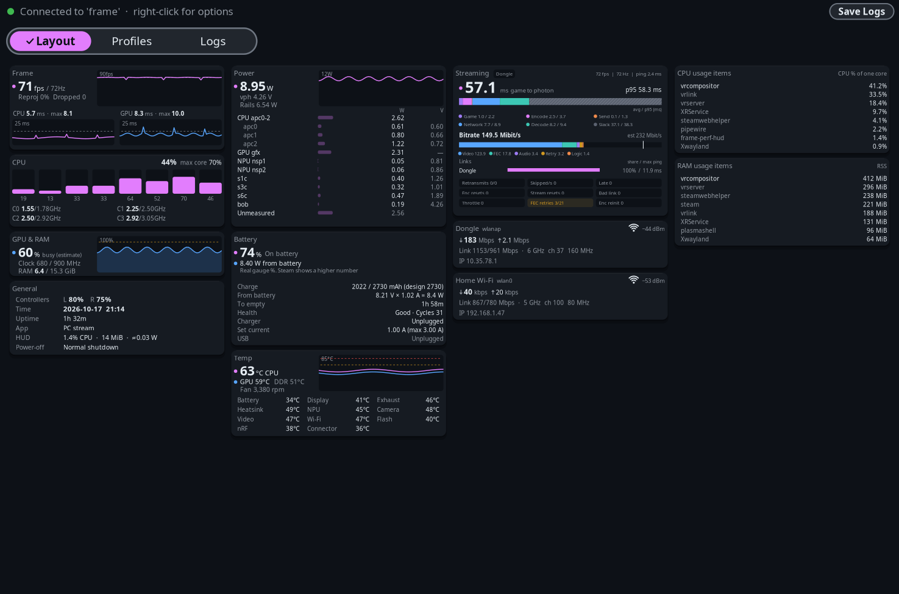
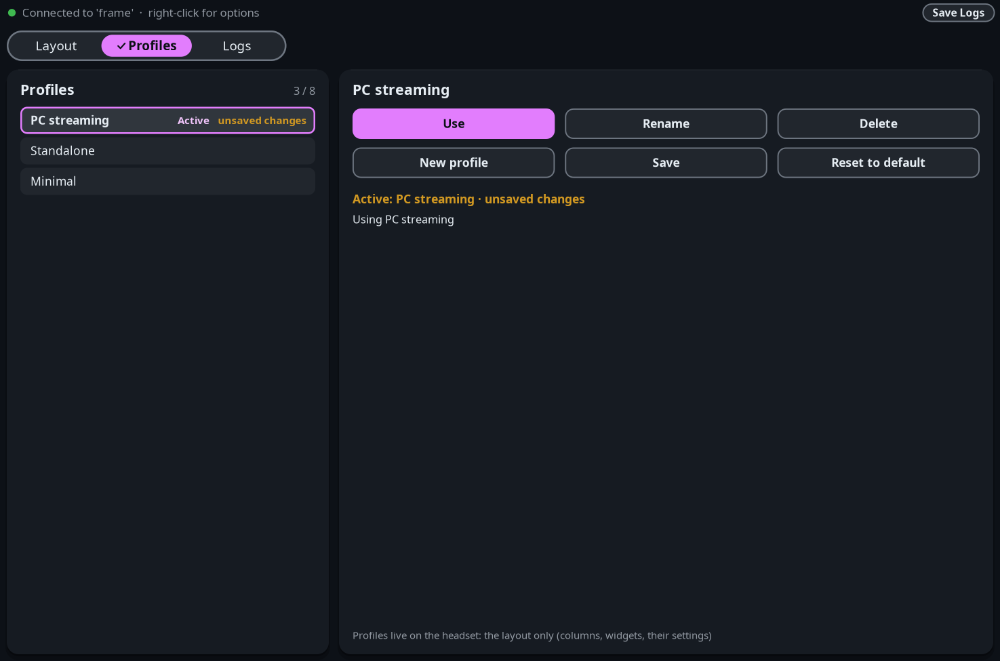
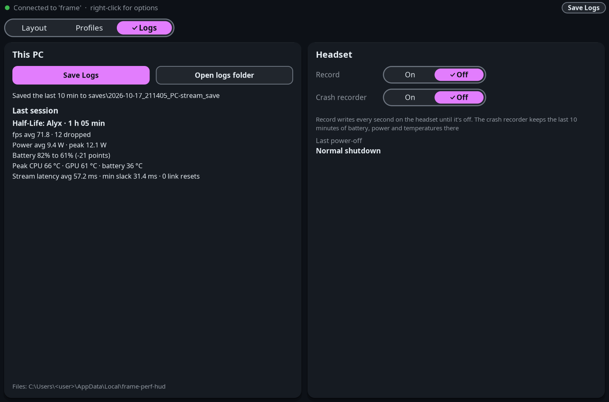

# frame-perf-hud

An extended version of [frame-perf-overlay](https://github.com/sasaken1102r/frame-perf-overlay) by sasaken1102r,
the performance HUD for the Valve Steam Frame. It keeps the original's in-VR readout of the app's frame rate, CPU
and GPU load, temperatures, power draw and battery, and adds a lot on top:

- **Network:** a widget per wireless link, the Steam Link dongle and home Wi-Fi, with traffic, signal, link rates,
  band, channel and IP.
- **Streaming:** while streaming from a PC, the game-to-photon latency and each of its stages, the bitrate, every
  link's share and ping, and the stream's error counters, measured from both the headset and the PC.
- **Usage items:** the processes using the most CPU and the most memory.
- **Camera feeds:** the headset's outward cameras and eye cameras, live, through an optional helper that needs sudo
  once.

The HUD runs on the headset itself (aarch64 SteamOS) as an OpenVR overlay and needs no sudo. A Windows app mirrors
it, edits its layout and adds the PC's side of the stream.

https://github.com/user-attachments/assets/47c83a1f-5199-4b92-8055-59b419db86d4

*Inside the headset: the dashboard tab's pages, the HUD pinned in the room and curved, and live widgets including
the eye cameras (45 s, no sound).*



The HUD is a grid of widgets that can be added, removed and dragged around, and some of them also have a short
compact card. It can sit in front of the eyes, on a wrist like a watch, or pinned at a spot in the
room, where it can also be curved around the viewer.

Everything is set from a **Frame Perf HUD** tab in the SteamVR dashboard, with four pages: Placement, Layout,
Profiles and Logs.

---

**Placement:** show or hide the HUD, its size, opacity and clock, and where it sits: head, wrist or a spot in the room.



---

**Layout:** drag widgets between columns, add them from the palette, and tap one to change its settings.



---

**Profiles:** keep up to 8 layouts and switch between them.



---

**Logs:** Save Logs, Record, the crash recorder, the last power-off reason and the last session's card.



---

The screenshots in this README were written out by the app itself (`--dump-png`, `--dump-settings-png` and the
preview tools), not captured inside the headset. Their numbers are sample values; the video above is real.

## What it does

- Shows the headset's performance live in VR: frame rate and frame times, CPU, GPU, memory, power, battery,
  temperatures, fan, Wi-Fi, controllers and the running app.
- Shows PC streaming (Steam Link) from both ends: the end-to-end latency and its stages, the bitrate, each wireless
  link, and the stream's error counters.
- Shows the headset's outward and eye cameras, with an optional helper.
- Lets the layout be built from widgets, on the headset or on the PC, and kept in up to 8 profiles.
- Logs game sessions: the samples stay in memory during play and each finished session is saved afterwards. Plus
  Save Logs, Record and an optional crash recorder.
- Tells why the headset last powered off.
- Reads only what's needed: sensor reads pause when the HUD is hidden or the headset is off the head, unless the
  dashboard tab, a connected PC, Record or the crash recorder still needs them.
- Updates itself from GitHub on both the headset and the PC.

## What it shows

| Widget | Main number | Details | Graph (last 30 s) |
|---|---|---|---|
| Frame | The app's frame rate and the display refresh rate (e.g. `72 fps / 72Hz`) | Reprojection ratio and dropped frames. CPU and GPU frame time (average and worst) | Frame rate with the refresh rate as a dotted line, and below it CPU and GPU frame-time graphs (the worst frame of each half second) against a dotted frame budget. A yellow badge shows when SteamVR holds the app at half (or a third) of the refresh rate |
| CPU | Overall load and the busiest core | One bar per core, the clock of each cluster, and a note when a cluster is capped below its hardware maximum | |
| GPU & RAM | GPU load: the GPU time per frame SteamVR measures × the app's frame rate (see below) | GPU clock and maximum, memory used and total | GPU load |
| Power | Power drawn from the main supply rail (W) | Its voltage, the sum of the measured rails, then every rail with its power and voltage, and what no rail accounts for | Main rail power |
| Battery | The battery's real gauge percentage | Power flowing in or out, charge and capacity, time to full or empty, health and cycles, the charger's mode and charge current, and with a USB-C charger what it offers against what arrives | |
| Temp | CPU temperature (hottest core) | GPU, memory, battery, NPU, cameras, video block, display, exhaust, heat sink and four board spots, fan speed | CPU and GPU, with the warning threshold. A red badge appears while heat throttles the CPU or GPU |
| CPU usage items | | The processes using the most CPU (% of one core) | |
| RAM usage items | | The processes using the most memory | |
| Network | Data flowing in and out (Mbps) | One adapter per widget, the Steam Link dongle or home Wi-Fi: signal, link rates, band, channel, width, IP | |
| Streaming | Game-to-photon latency while streaming from a PC | Its stages (game, encode, send, network, decode, slack), the bitrate by kind, each link's share and ping, and counters for retransmits, skipped and late frames, resets, bad links and throttling. Needs the Windows app | |
| General | | Controller batteries (a bolt while charging), the time, uptime, the running app, the HUD's own CPU, memory and power cost, the last power-off reason, and a note when a crash log was kept | |
| Headset camera | | The outward cameras, live. Needs the camera helper | |
| Eye camera | | The eye cameras, live. Needs the camera helper | |

Numbers over a threshold turn yellow, then red past a second one. The thresholds are in the settings file.

**GPU load** counts only the VR app and the SteamVR compositor, not other programs using the GPU, so it isn't the
GPU usage of the whole headset. It's capped at 100 % when GPU work overlaps, and shows N/A while no app is
submitting frames. The kernel's per-process GPU counters aren't used: on SteamOS 0.5.6 they're broken or miss most
of a heavy game's work. Half-Life: Alyx at 72 Hz (58.6 fps, 16.5 ms) reads about 97 %.



Frame, Power, Battery, Temp and Streaming also have a **compact** card with only the main numbers:



## Requirements

- A Steam Frame with Developer Mode on and SSH access (or Konsole on the headset).
- No sudo for the HUD itself. Only the optional camera helper needs it, once.
- For the Windows app: Windows 10 or 11 (64-bit). For the Streaming widget: SteamVR on that PC, streaming to the
  Frame with Steam Link.

## Install on the headset

1. Download `frame-perf-hud-<version>.tar.gz` from the [latest release](https://github.com/finaea/frame-perf-hud/releases/latest)
   and copy it to the headset (for example with `scp`).
2. On the headset:

   ```sh
   tar -xzf frame-perf-hud-<version>.tar.gz
   cd frame-perf-hud
   ./install.sh
   ```

`install.sh` installs everything into the home folder, turns on autostart and starts the HUD if SteamVR is
running. It puts:

- the program in `~/.local/bin/frame-perf-hud`,
- the bundled font, the update script and the camera helper's files in `~/.local/share/frame-perf-hud/`,
- the launcher entry and icons in `~/.local/share/applications/` and `~/.local/share/icons/`,
- a systemd user service that starts and stops with SteamVR: `~/.config/systemd/user/frame-perf-hud.service`,
- folders for settings and logs: `~/.config/frame-perf-hud/` and `~/.local/state/frame-perf-hud/`.

If frame-perf-overlay (the app this is forked from) is set to start with SteamVR, `install.sh` asks whether to turn
it off, so two HUDs don't run at once. `./install.sh --no-autostart` installs without turning autostart on.

To uninstall, run `./install.sh --uninstall` from an unpacked release folder. It removes everything above except
the settings in `~/.config/frame-perf-hud/`, and prints the command to delete those too. Session logs and saves go
with it.

### Optional: the camera helper

The Headset camera and Eye camera widgets need a small helper that can borrow the camera frames the headset's
tracking service already captures. A normal user isn't allowed to do that, so the helper is installed once with
sudo:

```sh
sudo ~/.local/share/frame-perf-hud/install-camera-helper.sh
```

- It installs `/home/.frame-perf-hud/fph-camgrab`, owned by root, with one capability (`cap_sys_ptrace`) and
  nothing else. `/home` keeps it through SteamOS updates.
- The helper only hands the HUD the frames. It never changes a camera's settings, never stops or starts a camera,
  and never touches tracking. It only talks to the headset's own camera and eye-tracking services.
- Nothing else in frame-perf-hud needs sudo.
- When a new version changes the helper, `install.sh` says so; running the same command again updates it.
- To remove it: `sudo ~/.local/share/frame-perf-hud/install-camera-helper.sh --uninstall`.

## The Windows app



The Windows app shows the same widgets in a window on the PC, and has its own Layout, Profiles and Logs tabs.

1. Download `FramePerfHud-<version>.exe` from the same release and run it. There's no installer: it's one file and
   can live in any folder.
2. Windows SmartScreen may warn the first time, because the exe isn't code-signed. **More info → Run anyway**
   starts it. The release notes link a VirusTotal scan of the exe.
3. The app looks for the headset on the network. The first time, the headset's dashboard tab shows "PC '<name>'
   wants to connect": **Allow** remembers that PC. A PC that is the Steam Link host is allowed on its own.
4. If the headset isn't found (for example on another subnet), its IP address can be entered under **Settings…**
   in the right-click menu.

The window's X hides the app to the tray, and **Exit** in the tray or right-click menu quits it. **Settings…**
also has **Start with Windows** (in the tray), the camera frame rate for the PC, and the update check.

Some antivirus tools may flag the exe because the Streaming widget reads statistics from SteamVR's own process.
That access is read-only and needs no administrator rights; see Privacy and safety below.

## Using it

The HUD shows up whenever SteamVR runs. Its settings are in the SteamVR dashboard: open it and pick the
**Frame Perf HUD** tab, then point with the laser and click. The tab has four pages, switched at the top.

### Placement

| Control | What it does |
|---|---|
| Show: On / Off | Show or hide the HUD. While it's hidden, it isn't drawn, and its sensors pause unless the dashboard tab, a connected PC, Record or the crash recorder still needs them |
| Column − / + | The width of one widget column, in 2 cm steps (6 cm to 1 m). The HUD is that × its number of columns |
| Opacity − / + | 10 % steps (20 % to 100 %) |
| Clock: Off / 12h / 24h | The Time row in the General widget: hidden, 12-hour or 24-hour |
| Reset | Back to the default show, attachment, position, facing, fade, clock, size and opacity |
| Attach to: Head / L hand / R hand / Room | In front of the eyes, on a controller like a wristwatch, or pinned at a spot in the room (it stays there in games too). Each hand keeps its own position and facing |
| Top L / Top R / Bottom L / Bottom C / Bottom R (head) | Move it to that corner of the view |
| Default wrist position (hand) | Put that hand's HUD back to the standard place and facing |
| Bring it in front of me (room) | Put it 1 m ahead at eye height, facing the viewer. The first switch to Room does this too |
| Moving it (room) | While the dashboard is open, point the laser at the HUD itself, hold the trigger and move it. Letting go leaves it there |
| Curve − / + (room) | Wrap the HUD around the viewer, from flat to 90° of arc in 10° steps |
| Nudge: Left / Right / Up / Down, Closer / Farther | Head: 2 cm (5 cm for closer / farther). Hand: 1 cm along the HUD's own axes. Room: 2 cm (5 cm) along the HUD's own axes |
| Facing: Left / Right / Up / Down, Rotate L / R | Turn or spin the HUD by the chosen step (By 1° / By 5°) |
| Face me / Face ahead | Head: turn it to face the head, or back to parallel with the face. Room: turn it in place to face the viewer, upright |
| Fade on tilt, Fade angle (hand) | Fade the wrist HUD as its face turns away |

### Layout

- **Left:** the HUD's columns, one card per widget. Press on a card, drag it and let go where the pink marker shows:
  within a column, into another one, or into the dashed **New column** lane. A column that ends up empty goes away.
  The thumbstick or trackpad scrolls when the columns are taller than the card.
- **Right:** **Widgets**. A tap adds one (under the selected card, or at the end of the shortest column), or it can
  be dragged into a column. Ticked widgets are already on; Network can be added more than once. Dragging a card
  onto this side, or **Remove**, takes it off.
- **A tap on a card** selects it and shows its settings: **Compact** for Frame, Power, Battery, Temp and Streaming;
  rows, **One row per name** and **Hide system** for the process lists; the adapter for Network; which cameras,
  full size and frame rate for the camera widgets.
- Every change is saved at once. If the Windows app changed the layout in the meantime, the page says so and shows
  the newer one.

### Profiles

| Control | What it does |
|---|---|
| The list | The saved profiles (up to 8). The active one says **Active**, and **unsaved changes** after any edit, made on the headset or the PC |
| Use | Make the selected profile the layout. With unsaved changes, it asks for a second tap |
| Rename | Rename the selected profile with SteamVR's keyboard |
| Delete | Delete the selected profile (two taps) |
| New profile | Save the current layout as a new profile ("Profile N") and make it active |
| Save | Save the current layout into the active profile |
| Reset to default | Put the built-in default layout up. The saved profiles stay as they are until Save. With unsaved changes, it asks for a second tap |

A profile holds only the layout: the columns, the widgets and their settings. Placement and app settings stay as
they are.

### Logs

| Control | What it does |
|---|---|
| Record: On / Off | Write every second to a file until it's turned off. The sensors keep being read while it's on, even with the HUD hidden |
| Save Logs | Write the last 10 minutes and the current session's summary right away |
| Crash recorder: On / Off | Keep the last 10 minutes of battery, power and temperatures on disk (one small write a second), so a crash or power cut leaves a log. Off by default |
| Last power-off | Why the headset last switched off: a normal restart, a normal shutdown, or the power controller's raw registers when the reason isn't known yet |
| Last session | The card of the last game session: length, frame rate and drops, power, battery used, peak temperatures and, when streaming, latency and link resets |

Game sessions are logged by themselves. The samples stay in memory while playing, and when a game ends, its
summary and timeline are written once. Samples are only taken while something is reading the sensors (the HUD
shown and worn, the dashboard tab open, a connected PC or Record), so a session with less than a minute of samples
is skipped, even if the game ran longer. A session ends a minute after its game quits with nothing else started: it
ends at the moment the game left, and that minute isn't counted. A short trip to SteamVR Home, or the same game back
within the minute, doesn't split a game. The HUD also shows the session card for 10 seconds.

### Bottom row

| Control | What it does |
|---|---|
| Language | English only for now |
| Autostart: On / Off | Start the HUD with SteamVR (from the next SteamVR start) |
| Forget PCs (N) | Forget every PC that was allowed to connect |
| Quit app | Click twice within 3 seconds to quit. It stays off until the next SteamVR start |

The + button ("launch a program") in the dashboard lists **Frame Perf HUD**. Launching it while it runs shows or
hides the HUD.

### The Windows app's tabs

| Tab | What it shows |
|---|---|
| Layout | The HUD's widgets, live. **Edit layout** in the right-click menu (or Ctrl+E) switches to the same editor as the dashboard's: drag cards, add widgets from the palette, change a widget's settings |
| Profiles | The headset's profiles, with the same buttons as the dashboard (Rename opens a text box). The headset makes the change, so both stay in step |
| Logs | **This PC:** Save Logs, Open logs folder and the last session's card. **Headset:** the Record and Crash recorder switches and the last power-off reason |





The status bar's **Save Logs** and the right-click menu do the same as the Logs tab's buttons.

## Files and settings

### On the headset

| Path | What |
|---|---|
| `~/.config/frame-perf-hud/config.json` | All settings and the layout. Missing keys keep their defaults, and changes are picked up while it runs. [`contrib/config.example.json`](contrib/config.example.json) has every key at its default |
| `~/.config/frame-perf-hud/hide_rules.json` | What **Hide system** leaves out of the process lists. Written with a built-in list the first time, then read again whenever it changes |
| `~/.config/frame-perf-hud/profiles/` | One file per profile |
| `~/.local/state/frame-perf-hud/sessions/` | One summary (`.json`) and timeline (`.csv.gz`) per game session; the last 10 are kept |
| `~/.local/state/frame-perf-hud/saves/` | Save Logs and Record files; the last 20 are kept |
| `~/.local/state/frame-perf-hud/crashes/` | Crash logs from the crash recorder; the last 5 are kept |

Settings that differ from frame-perf-overlay's:

- `attachment` can also be `"detached"` (Room); `detached_pose` holds its spot and `detached_curve_deg` its curve
  (0 to 90).
- `width_m` is the width of **one column** of widgets (default 0.2 m), so text keeps its size whatever the layout.
- `layout` is the widget grid: `columns` is a list of columns, each a list of widgets from top to bottom. Types:
  `frame`, `cpu`, `gpu_ram`, `power`, `battery`, `temp`, `cpu_items`, `ram_items`, `network`, `streaming`,
  `general`, `headset_camera`, `eye_camera`. Per widget: `compact`; `max_items`, `sum_same_name` and `hide_system`
  for the process lists; `adapter` (`"dongle"` or `"home"`) for Network; `cameras`, `full_size` and `fps` for the
  cameras. A widget that isn't listed is off and reads nothing.
- `crash_recorder` turns the crash recorder on, and `active_profile` names the active profile.
- `link` holds the PC link's UDP port (47630) and the allowed PCs.
- `font` / `font_bold` empty means the bundled Noto Sans. `language` is `"en"` for now.

`hide_rules.json` looks like this. `name` matches a process's name or its program file's name, `cgroup` matches its
cgroup path, `*` and `?` work as wildcards, and a rule with both needs both:

```json
{
  "version": 1,
  "hide": [
    {"name": "vrserver", "note": "SteamVR server"},
    {"name": "steamwebhelper"},
    {"cgroup": "/system.slice/*"}
  ]
}
```

### On the PC

Everything is in `%LOCALAPPDATA%\frame-perf-hud\`:

| Path | What |
|---|---|
| `settings.json` | The app's settings: the PC's id, the manual IP, remembered headsets, window placement, update check |
| `layout-cache.json` | The last layout, shown greyed until the headset answers |
| `pc.log` | The app's log, started fresh on every start |
| `sessions\` | The PC's copy of each headset session; `sessions\pc-stream\` the PC's own streaming stats per game |
| `saves\` | Save Logs files |
| `update\` | Downloads of a new version, while one is being installed |

## Updates

- **Headset:** the dashboard tab shows the running version and checks GitHub for a newer release at start and
  then about once a day; after a failed check it tries again an hour later. **Check now** checks right away, even
  with `"update_check": false` in `config.json`. Installing downloads the release, checks it against the release's
  SHA-256 sums and runs its `install.sh`.
- **PC:** the app checks the same releases the same way: at start, about once a day, and an hour after a failed
  check (a switch in **Settings…**, with **Check now**). When a newer one is out, the status bar and the tray menu offer **Install**: it downloads
  `FramePerfHud-<version>.exe`, checks its SHA-256, puts it in place of the running exe and restarts. If the exe
  sits in a folder it can't write to, it opens the release page instead.
- Each release has matching headset and PC downloads, but each side is updated on its own: updating the headset
  doesn't update the PC app, or the other way round. Keeping both on the same version works best.

## Privacy and safety

- **No telemetry.** Nothing is sent anywhere except the GitHub update checks, update downloads when an install is
  asked for, and the link between the headset and PCs on the local network.
- **The headset** reads its sensors from sysfs and `/proc` and never writes there. For the network it reads the
  adapters' names, local IP addresses, signal, frequency, channel width, link rates and byte counters (no MAC
  addresses, no SSIDs). For the stream it counts a few kinds of vrlink log lines in the user journal, and once per
  boot it reads the power controller's lines from the kernel log.
- **The link** uses UDP port 47630. To find the headset, the PC sends its generated id and computer name on the
  local network, and the headset answers any PC with its own id, name, local IP addresses, whether that PC is
  allowed, and its layout version. Only PCs allowed on the dashboard (or the current Steam Link host) receive stats,
  process lists or camera pictures, or may change anything. The traffic isn't encrypted, so on a shared or public network the stats and
  camera pictures could be seen by others there; at home, the Steam Link dongle's network and home Wi-Fi are
  protected by the usual Wi-Fi security.
- **The Windows app** reads SteamVR's own statistics from `vrserver.exe`'s memory with read-only access, reads a
  few counters from SteamVR's vrlink log, and connects to SteamVR as a background app for the ping. It never writes
  to SteamVR's memory, files or settings.
- **The camera helper** holds one capability and can only do the few fixed things the HUD asks for. Camera pictures
  go to a PC only when that PC asks for them and a camera widget is on.
- **Files written:** its own settings, profiles, logs and caches (listed above), the updaters' small caches, and
  a lock file and the debug dump in `/run/user/<uid>` (memory only). Session samples stay in memory during play and
  are written after the session ends; Save Logs, Record and the crash recorder can write while a game runs, and
  changing settings or the layout saves them right away.

## Troubleshooting

- **Logs:** on the headset, `journalctl --user -u frame-perf-hud -f`. On the PC, `%LOCALAPPDATA%\frame-perf-hud\pc.log`.
- **No HUD:** check that SteamVR runs, that **Show** is on, and `systemctl --user status frame-perf-hud`.
- **`--` or N/A instead of a value:** that sensor wasn't found or couldn't be read, and N/A comes with a short
  reason. `frame-perf-hud --print` lists what was found.
- **What is it reading?** `frame-perf-hud --debug-dump` prints every source with its read counter and every value
  with its status. Run it twice: if the counters don't move, nothing is being read.
- **The PC app doesn't find the headset:** check that the headset's dashboard tab doesn't show a pending
  **Allow**, and try the headset's IP under **Settings…**. The app and the headset need to be on the same network.
- **The Streaming widget shows nothing:** it needs the Windows app running on the streaming PC with a Streaming
  widget in the layout, and SteamVR running there. After a SteamVR update, a detail that can't be read safely shows
  N/A with a note until the app is updated.
- **The camera widgets say the helper is missing or outdated:** install it with the command above. When an update
  changes the helper, `install.sh` says so, and the same command updates it.

## Building from source

### On the headset

The toolchain and the libraries are already on SteamOS: cmake, ninja, g++, pkg-config, and the cairo, freetype2,
vulkan, libnl-genl-3.0, libsystemd, libturbojpeg and zlib development files.

```sh
git clone https://github.com/finaea/frame-perf-hud ~/projects/frame-perf-hud
cd ~/projects/frame-perf-hud
cmake -G Ninja -S . -B build
cmake --build build
ctest --test-dir build --output-on-failure
./install.sh
```

`scripts/package.sh` makes the release tarball (`dist/frame-perf-hud-<version>.tar.gz` and its `SHA256SUMS` line).

### On Windows

It needs Visual Studio 2022 with the C++ workload and a vcpkg checkout (see [`pc/README.md`](pc/README.md)):

```bat
pc\build.cmd          :: out\pc\build\pc\FramePerfHud.exe
pc\build.cmd test     :: ... and run the PC tests
pc\package.cmd        :: a clean release build: dist\FramePerfHud-<version>.exe and its SHA256SUMS line
```

Releasing both halves is described in [`docs/RELEASING.md`](docs/RELEASING.md).

## Development

`core/` (the metric registry, value store, scheduler, layout and link format) and `core/render/` (the widgets) are
shared by the headset and the Windows app. `headset/` is the Frame agent, `pc/` the Windows app, and `helper/` the
camera helper.

The images in this README come from the apps themselves:

```sh
# On the headset (or any Linux build with the headset parts), without SteamVR
./build/frame-perf-hud --dump-png panel.png --seconds 30 --fake-frames
./build/frame-perf-hud --dump-png warnings.png --seconds 30 --fake-warnings --fake-throttle
# the dashboard pages with default settings (a --config path that doesn't exist means defaults)
./build/frame-perf-hud --config /tmp/none.json --dump-settings-png dashboard-placement-en.png --preview-page placement
./build/frame-perf-hud --config /tmp/none.json --dump-settings-png dashboard-layout-en.png --preview-page layout
./build/frame-perf-hud --config /tmp/none.json --dump-settings-png dashboard-profiles-en.png --preview-page profiles
./build/frame-perf-hud --config /tmp/none.json --dump-settings-png dashboard-logs-en.png --preview-page logs
```

```bat
:: On Windows, after pc\build.cmd (it builds these tools too): the HUD images, the window and its tabs, the
:: Streaming widget's states (sample values, shared renderer)
out\pc\build\pc\fph-docs-images.exe docs\images
out\pc\build\pc\fph-pc-pages-preview.exe out\previews
out\pc\build\pc\fph-streaming-preview.exe out\previews
```

Other options that work without SteamVR: `--print`, `--dump-metrics`, `--contrast-report`. `vendor/frame-updater/`
is a copy of frame-perf-overlay's updater; `scripts/package.sh` checks that it's unchanged.

## Language

English only. The strings are in one table (`headset/i18n.cpp`), so other languages are welcome as a pull request.

## Disclaimer

Unofficial. Not affiliated with or endorsed by Valve Corporation. Steam, Steam Frame, SteamVR and Steam Link are
trademarks of Valve Corporation. Use at one's own risk; there's no warranty (see [LICENSE](LICENSE)).

## License

MIT, see [LICENSE](LICENSE), which keeps the original author's copyright line. Third-party code, the bundled font
and the system libraries used at run time are listed in [THIRD_PARTY_LICENSES.md](THIRD_PARTY_LICENSES.md).

## Credits

- [frame-perf-overlay](https://github.com/sasaken1102r/frame-perf-overlay) by sasaken1102r, which this is forked
  from, including its update helper.
- Wrist attachment, the clock and the tilt fade in frame-perf-overlay by [TaiKeid](https://github.com/TaiKeid)
  ([#1](https://github.com/sasaken1102r/frame-perf-overlay/pull/1)).
- The smaller release build in frame-perf-overlay by [cinnacappu](https://github.com/cinnacappu)
  ([#2](https://github.com/sasaken1102r/frame-perf-overlay/pull/2)), adapted here.
- The eye camera discovery is ported from [FrameEyeCameraFeed](https://github.com/Curtis-VL/FrameEyeCameraFeed)'s
  framestream by Curtis English.
- [Noto Sans](https://github.com/notofonts/latin-greek-cyrillic) by the Noto Project Authors, and the
  [OpenVR SDK](https://github.com/ValveSoftware/openvr) by Valve. The full list is in
  [THIRD_PARTY_LICENSES.md](THIRD_PARTY_LICENSES.md).
